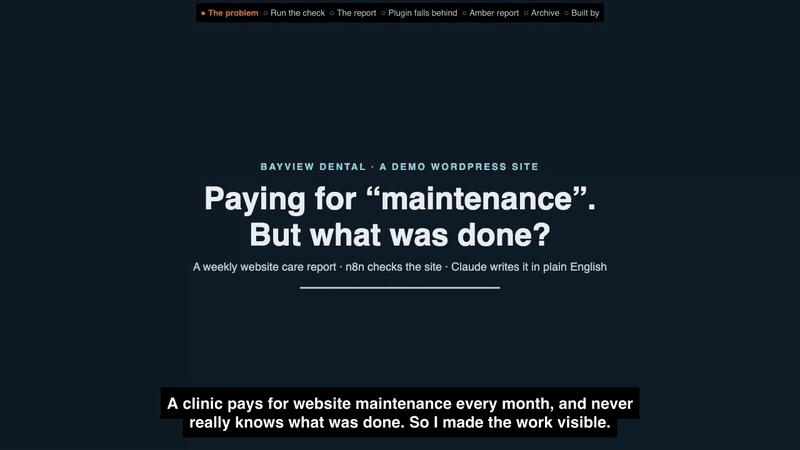

# WordPress Care-Plan Report (n8n + Claude)

A weekly "website care plan" report for a clinic owner who is not technical. Every Monday at 08:00 an n8n workflow checks a WordPress site (is it online, updates waiting, WordPress/PHP versions, PHP errors, last backup, a Lighthouse speed score), Claude writes a plain-English report with a green/amber/red status and a short to-do list, code checks every number in it against the real data, and the report is saved, emailed and kept in an archive.

**What this proves:** an n8n workflow that checks a WordPress site (uptime, updates, versions, PHP errors, backup age, Lighthouse), has Claude write a plain-English report, and then checks in code every number Claude wrote against the real data before the report is saved and emailed. `./check.sh` runs it twice end to end.

[](demo/p6-demo.mp4)

15-second preview at 5x speed. Click it for the full 88-second narrated demo (`demo/p6-demo.mp4`).

**Live case study:** https://mckenneth.vercel.app/case-studies/wp-care-report/

**`./check.sh`, run on 16 Oct 2026 from a fresh clone** against the Docker stack below with live Claude calls (real output):

```text
parse ok: 12 cases
[restore] healthy snapshot restored
[install] mu-plugin + care-bot ready, health endpoint 200
run 1: {"report_id":1,"status":"amber","emailed":true}
p6 ok: status amber
p6 ok: actions present, uptime ok, emailed
p6 ok: 1 email to the owner, subject: Website care report — Bayview Dental — 2026-10-16 — AMBER
run 2: {"report_id":2,"status":"amber","emailed":true}
p6 ok: status amber with an outdated plugin and no backup
p6 ok: an action says to update / back up
p6 ok: 2nd email sent
p6 PASS (site back to contact-form-7 6.2.1, fresh backup)
```

Run 1 was amber, not green, because wordpress.org had released updates since the demo was filmed (Contact Form 7 6.2.2, Elementor 4.3.5 and a theme update). Claude's headline: "Your site is online and was backed up today, but 3 updates are waiting to be installed this week." Run 2 added the missing backup to the to-do list.

**Caveat:** demo clinic with fictional data (Bayview Dental), not client work. The email goes to a local test mailbox (Mailpit), and "online" means 3 requests at report time, not 24/7 monitoring (see Honest notes).

## What you get

- An email to the owner: status pill, one-line headline, short sections (Online and speed, Updates, Backups, Errors), "What to do" with effort (quick/medium/large), and a table of the real numbers underneath.
- A report archive page (`report-archive.html`, every run, newest first).
- A read-only health check on the WordPress site (`mu-plugin/bayview-health.php`) and a backup script that records when it last ran.

The two runs filmed in the demo (`demo/run.json`), the second after Contact Form 7 was put back to 6.1.7 on purpose:

| Run | Status | Online | Speed score | Updates waiting | Backup age | Numbers swapped by the guard | Emailed |
| --- | --- | --- | --- | --- | --- | --- | --- |
| #1 | GREEN | 3/3, avg 137 ms | 74 (LCP 5.7 s) | 0 | 0 days | 0 | yes |
| #2 | AMBER | 3/3, avg 305 ms | 77 (LCP 5.3 s) | 1 | 0 days | 0 | yes |

Report #2, as Claude wrote it: "Your website is online and backed up today. One add-on needs an update this week." Actions: "Update the contact form add-on from version 6.1.7 to 6.2.1." (quick), "Make the main part of the home page show up faster." (medium).

## How it works

The n8n workflow (`workflow.json`, id `vaP6CareReport`):

```
Every Monday 08:00 Asia/Manila (Schedule)  or  Run now (Webhook POST /webhook/care-run)
  -> Uptime x3      Code: 3 timed GETs of the home page, 1 s apart
  -> Health         HTTP GET /wp-json/bayview/v1/health, basic auth = care-bot's application password
  -> Lighthouse     HTTP POST bridge.mjs /p6/lighthouse (one mobile run: score, LCP, page weight)
  -> Build prompt   Code: one `data` object + the brief (plain English, strict JSON, only numbers from DATA)
  -> Ask Claude     HTTP POST bridge.mjs /reply -> `claude -p`
  -> Parse          Code (parse.js): strict JSON, status floor from the data, numbers guard, must-have actions
  -> Save           Postgres p6_reports (data + report)
  -> Render email   Code: escaped HTML (status, headline, sections, to-do, numbers table)
  -> Send email     SMTP to owner@bayviewdental.example (Mailpit locally)
  -> Mark emailed / Respond  { report_id, status, emailed }
```

The health check (`mu-plugin/bayview-health.php`) returns `{wp_version, php_version, plugins:[{slug, version, update}], theme_updates, core_update, debug_errors_24h, last_backup_at, disk_uploads_mb}`. Only a user with the custom `bayview_health` capability may call it (admins get 401 too); `install.sh` creates that `care-bot` subscriber and its application password.

Parse rules (`parse.js`, tested by `parse.check.mjs`):
- Status floor from the data: red if a probe failed or the health check is unreadable; amber if updates are waiting, the backup is missing or older than 7 days, PHP errors were logged, or the speed score is missing or under 50. Claude can raise the status, never lower it.
- Numbers guard: every digit-number in the headline, section text and actions must appear in the run's data (versions like 6.2.1 count as one number, thousands commas and leading zeros are normalised). A field that fails is replaced by a template sentence (an action is dropped) and counted in `guarded`.
- Required actions are added if Claude leaves them out (back online, update with the slugs, back up). A failed Claude call or bad JSON gives a template report built from the data.

| File | What it is |
| --- | --- |
| `workflow.json` | the n8n workflow |
| `parse.js`, `parse.check.mjs` | the Parse node's code and its 12-case check (also asserts it matches the code inside `workflow.json`) |
| `mu-plugin/bayview-health.php` | the read-only health endpoint |
| `install.sh` | puts the mu-plugin into the site, creates `care-bot` + its application password, imports the n8n credential `vaP6CareBot` |
| `backup.sh` | `wp db export` + a `wp-content` tar into `backups/` (keeps 2), records the time the health check reports |
| `schema.sql` | the `p6_reports` table |
| `pg-credential.json`, `smtp-credential.json` | n8n credentials for the local Postgres (`va`/`va`) and Mailpit (no auth). No secrets. |
| `bridge.mjs` | tiny local server: `/reply` calls the `claude` CLI, `/p6/lighthouse` runs Lighthouse, serves the archive |
| `report-archive.html` | the archive page (reads `/p6/state`) |
| `check.sh` | end-to-end: healthy run -> report saved and emailed; then a plugin behind + no backup -> amber/red with an update/backup action |
| `shots.mjs`, `img/` | screenshots of the email and the archive |
| `demo/` | scripts that recorded the demo video (Playwright capture, cloned-voice narration, ffmpeg assembly) and `p6-demo.mp4` |
| `case-study.html` | the case study page |

## How to run

Needs Docker, Node 22, Google Chrome (for Lighthouse; set `CHROME_PATH` off macOS) and the [Claude Code](https://claude.com/claude-code) CLI (`claude`) logged in.

The site it watches is [mcknx/wp-site-rescue](https://github.com/mcknx/wp-site-rescue) (a demo clinic WordPress site on http://localhost:8092). Clone it next to this repo, or point `SITE_DIR` at it:

```bash
git clone https://github.com/mcknx/wp-site-rescue ../wp-site-rescue
(cd ../wp-site-rescue && assets/fetch-photos.sh && ./seed.sh)   # healthy site on :8092

cp .env.example .env            # set N8N_ENCRYPTION_KEY
docker compose up -d             # n8n :5678, Postgres, Mailpit :8025 (web UI) / :1025 (SMTP)
docker exec -i va-pg psql -U va -d va < schema.sql
docker exec n8n n8n import:credentials --input=/demo/pg-credential.json
docker exec n8n n8n import:credentials --input=/demo/smtp-credential.json
./install.sh                     # mu-plugin + care-bot + n8n credential vaP6CareBot, health check answers 200
./backup.sh
docker exec n8n n8n import:workflow --input=/demo/workflow.json
docker exec n8n n8n publish:workflow --id=vaP6CareReport
docker restart n8n               # pick up the published workflow

node bridge.mjs                  # :8788, keep it running
curl -X POST localhost:5678/webhook/care-run     # one report now (about 30-60 s)
```

Open http://localhost:8025 (the email) and http://localhost:8788/ (the archive). Or run the checks:

```bash
node parse.check.mjs             # the Parse rules, no services needed
./check.sh                       # restore site -> install -> backup -> green run -> plugin behind + no backup -> amber run -> site back
```

The n8n editor is at http://localhost:5678 (create the owner account on first open).

Pointing it at another WordPress site: copy `mu-plugin/bayview-health.php` into its `wp-content/mu-plugins/`, create a user with only the `bayview_health` capability and an application password, put that in the `vaP6CareBot` credential, and change the URLs/Host header in the Uptime x3 and Health nodes and `SITE_URL` for the bridge. Hook your real backup tool to update the `bayview_last_backup_at` option (a Unix time).

## Using a real mailbox and a real AI key

- Email goes to a local test mailbox (Mailpit) here. For a real client, change the `vaMailpit` SMTP credential to the provider's SMTP login (or replace Send Email with n8n's Gmail node). That swap is documented, not run here.
- Claude is called through `bridge.mjs`, a small local bridge to the `claude` CLI, so the demo runs on a Claude subscription without an API key. In production, swap the "Ask Claude" node for n8n's Anthropic node with the client's own API key and drop the bridge (keep a small endpoint, or n8n's Execute Command, for Lighthouse).

## Honest notes

- Demo clinic, fictional data. Bayview Dental is made up; addresses are `.example`. There is no paying client.
- "Online" is 3 requests at report time, a second apart, not 24/7 uptime monitoring.
- The speed score is one Lighthouse run per report, so it moves between runs (57 to 77 seen on the same site).
- The numbers guard checks digit-numbers only (number words like "three" are not checked), and the allowed set is the whole run's data, so a real number can still be put in the wrong place. The numbers table under every report comes straight from the data.
- WordPress turns application passwords off on plain http in production mode; the mu-plugin turns them back on so the local demo works. On a real site, use https.
- The site's home URL is `localhost:8092`, so n8n (in Docker) calls `host.docker.internal:8092` with a `Host: localhost:8092` header.
- `.care-bot-pass` (the generated application password), `.care-bot-cred` and `backups/` are gitignored and never committed.
- Re-recording the video: `demo/capture.mjs` needs Playwright (`npm i playwright` or set `PLAYWRIGHT_PATH`), and `demo/say-clone.py` needs your own voice clip via `REF=/path/to/clip.wav` (never committed).

Built by McKeen Asma with Claude Code. MIT licence.
